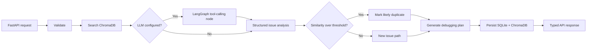

# Agentic AI Software Issue Triage Assistant

A portfolio-ready issue triage service that accepts bug reports, classifies their category and priority, retrieves similar reports, and recommends concrete debugging steps. It exposes a versioned FastAPI API and runs a LangGraph workflow over SQLite and ChromaDB.

## What it does

- Validates issue reports and keeps error responses free of submitted field values.
- Runs a graph with separate validation, retrieval, analysis, duplicate-routing, recommendation, and persistence steps.
- Uses Pydantic structured output for the classifier and recommendation generator.
- Uses LangGraph's `ToolNode` with LangChain tools for searching known issues and retrieving debugging playbooks when OpenAI is enabled.
- Stores triage results in SQLite and indexes report text in persistent ChromaDB for similarity search.
- Runs locally without credentials using deterministic rules and feature-hash embeddings. Configure OpenAI to use an LLM and hosted embeddings.
- Supports optional API-key protection, request IDs, health checks, Docker, and CI quality checks.

## Architecture



The OpenAI context pass may call `search_known_issues` and `get_debugging_playbook` through `ToolNode`. The workflow also performs a direct retrieval pass so duplicate detection does not depend on an LLM choosing to call a tool.

## Quick start

Requires Python 3.11 or 3.12.

```powershell
py -3.11 -m venv .venv
.\.venv\Scripts\Activate.ps1
python -m pip install -e ".[dev]"
Copy-Item .env.example .env
uvicorn issue_triage.main:app --reload --app-dir src
```

The service runs in local mode when no OpenAI key is configured. OpenAPI docs are available at [http://127.0.0.1:8000/docs](http://127.0.0.1:8000/docs); readiness is at `/health/ready`.

To enable the LLM and OpenAI embeddings, set `OPENAI_API_KEY` in `.env` and use `LLM_PROVIDER=auto` and `EMBEDDING_PROVIDER=auto`, or explicitly set either provider to `openai`. Set a provider to `local` to keep that part offline even when a key is present.

## Example request

```powershell
curl.exe -X POST http://127.0.0.1:8000/api/v1/triage `
  -H "Content-Type: application/json" `
  -d '{"title":"Checkout returns 500","description":"After upgrading the payment SDK, checkout fails with a TypeError when a customer has a saved card.","environment":"production, API v2","language":"Python","repository":"payments/api"}'
```

Example response (IDs and timestamps are generated per request):

```json
{
  "issue_id": "4a88a5ed-0ea4-4583-9048-58d985f92102",
  "title": "Checkout returns 500",
  "summary": "Checkout returns 500.",
  "category": "bug",
  "priority": "P2",
  "confidence": 0.76,
  "rationale": "The report matches common bug signals with moderate impact details.",
  "debugging_steps": [
    "Reproduce the failure with the smallest input and record the exact expected and actual behavior.",
    "Check the most recent code, configuration, and dependency changes around the affected path.",
    "Add a focused regression test that fails before the fix and passes after it.",
    "Capture relevant logs and state at the first point where behavior diverges."
  ],
  "tags": ["bug", "api"],
  "related_issues": [],
  "duplicate_of": null,
  "created_at": "2026-10-28T12:00:00Z",
  "analysis_mode": "local-rules"
}
```

## API

| Method | Path | Purpose |
| --- | --- | --- |
| `GET` | `/health/live` | Process liveness and configured modes |
| `GET` | `/health/ready` | SQLite and ChromaDB readiness |
| `POST` | `/api/v1/triage` | Classify, retrieve, recommend, and persist an issue |
| `GET` | `/api/v1/issues` | Paginate issue history; filter by category and priority |
| `GET` | `/api/v1/issues/{issue_id}` | Fetch a saved triage response |

Set `API_KEY` to require an `X-API-Key` header on issue endpoints. Health checks stay public for container orchestration. The local default leaves authentication disabled for easier evaluation; set an API key before exposing the service outside a trusted environment. The submitted report is stored in the local SQLite database and ChromaDB collection so retrieval can work across restarts.

## Configuration

| Variable | Default | Description |
| --- | --- | --- |
| `LLM_PROVIDER` | `auto` | `auto`, `local`, or `openai` |
| `OPENAI_API_KEY` | empty | Enables OpenAI in `auto` mode; required for explicit `openai` mode |
| `OPENAI_MODEL` | `gpt-4o-mini` | Chat model used for structured analysis and tool planning |
| `EMBEDDING_PROVIDER` | `auto` | `auto`, `local`, or `openai` |
| `OPENAI_EMBEDDING_MODEL` | `text-embedding-3-small` | OpenAI embedding model |
| `DATABASE_PATH` | `./data/issues.sqlite3` | SQLite issue history file |
| `CHROMA_PATH` | `./data/chroma` | Persistent ChromaDB directory |
| `RETRIEVAL_K` | `5` | Maximum related reports returned |
| `DUPLICATE_THRESHOLD` | `0.82` | Similarity threshold for `duplicate_of` |
| `API_KEY` | empty | Optional API key for issue endpoints |
| `ALLOWED_ORIGINS` | `[]` | JSON array of allowed CORS origins |
| `LOG_LEVEL` | `INFO` | Application log level |

Local feature-hash embeddings are deterministic and useful for a self-contained demo, but they do not provide the semantic coverage of a trained embedding model. Use OpenAI or a future configured embedding provider for production retrieval quality. Existing Chroma collections retain their original distance metric; use a clean data directory if changing the collection setup.

## Run with Docker

```powershell
docker compose up --build
```

Docker Compose persists SQLite and ChromaDB in the `triage-data` named volume. Pass `OPENAI_API_KEY` and `API_KEY` through the environment to enable hosted inference and authentication.

## Development

```powershell
ruff check .
mypy src
python -m pytest --cov=issue_triage --cov-report=term-missing
```

The test suite covers API validation and authentication, local workflow outputs, duplicate routing, history filtering, and deterministic embedding behavior. CI runs Ruff, mypy, and Pytest with coverage on Python 3.11.

## Resume-ready summary

**Agentic AI Software Issue Triage Assistant | Python, LangGraph, LangChain, FastAPI, ChromaDB, SQLite, Pytest**

- Built a typed issue triage API that summarizes bug reports, assigns categories and priorities, recommends debugging steps, and finds related issues through persistent vector search.
- Orchestrated validation, retrieval, tool calling, conditional duplicate routing, structured analysis, recommendations, and persistence as a LangGraph workflow.
- Added local offline mode, optional OpenAI structured outputs, API-key authentication, request IDs, health checks, Docker packaging, and CI quality gates.
- Covered API validation, auth, retrieval, duplicate detection, and workflow behavior with Pytest.
